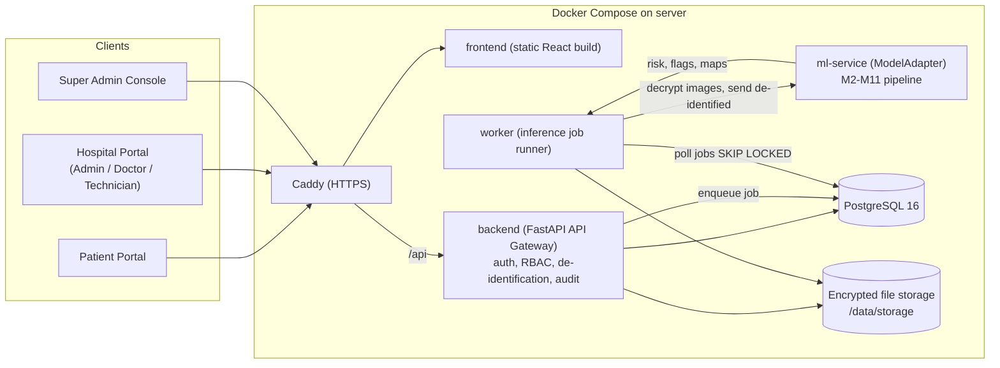
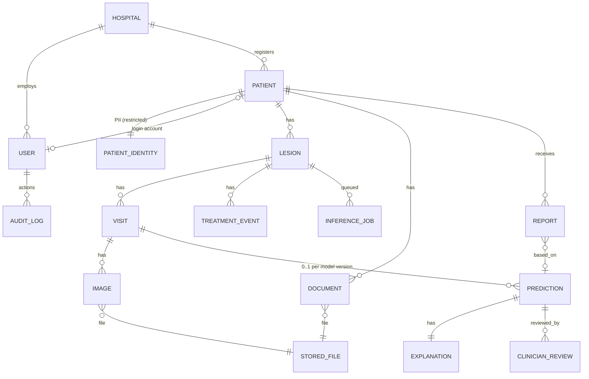
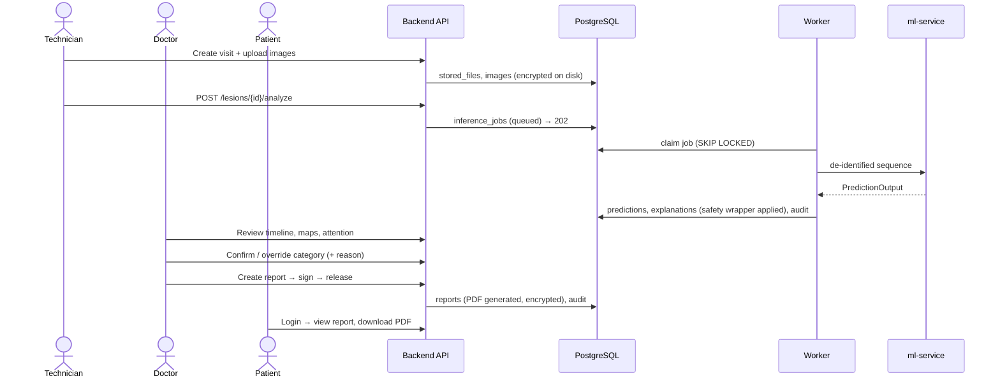

# MelanoTrack — Web Platform Implementation Document (v1.0)

**Project:** Longitudinal Multimodal AI for Early Prediction of Melanoma Progression and Treatment Response
**Team:** Aaditya Rajvinod (R23EF004), Sriram (R23EA122) · **Mentor:** Dr. Satheesha T.Y.
**Scope of this document:** The web interface, server and database that store patient scans and documents, run the AI model, and send reports back to patients and hospitals. This is design-doc component **S2 (Clinician Dashboard)**, **S3 (Audit Logger)** and the **API Gateway / Secure Storage** from Week 4 (Fig. 4). It also adds a **Patient Portal**.

> [!NOTE]
> "MelanoTrack" is a working product name. You can rename it at any point.

---

## 1. What the source documents require

| Source | Requirement for the web platform |
|---|---|
| Week 1 | Data is organised as **patient → lesion → visit (dated) → images**. Stable lesions are labelled by follow-up, progressed ones by biopsy, so **histopathology documents** must be storable. |
| Week 2 FR-01 | Ingest serial dermoscopic and clinical images linked by patient ID, lesion ID and visit timestamp. |
| Week 2 FR-02/08 | Optional 3D-TBP uploads and treatment records (*conditional*). |
| Week 2 FR-06/07/11 | Show the risk score, the category (routine / shortened-interval / referral) and the **uncertainty referral flag**. When the flag is set, the category is withheld. |
| Week 2 FR-09/10 | Show visit-attention weights, the difference map and Grad-CAM saliency. |
| Week 2 FR-12 | Subgroup fairness report (Fitzpatrick type, site, device, illumination). |
| Week 2 FR-13 | Clinician dashboard: timeline, risk trend, explanations, uncertainty. |
| Week 2 FR-15 / NFR-10 | Append-only audit log of every prediction, explanation, flag and clinician action. |
| NFR-01 | Analysis under 60 s server-side, using cached embeddings. |
| NFR-03 | Any failure defaults to a **dermatologist-review flag**, never a silent benign result. |
| NFR-06 | De-identification, encryption at rest and in transit, access control. |
| NFR-07 | DICOM in / FHIR out (later phase). |
| NFR-09 | Modular, so the model can be swapped or retrained independently. |
| Week 4 §6 | Entities: Patient, Lesion, Visit, Image, Prediction, Explanation, TreatmentEvent, AuditLog, User. |
| Week 4 §10 | REST endpoints: `POST /v1/visits/{id}/images`, `POST /v1/lesions/{id}/analyze`, `GET /v1/predictions/{id}/explanation`, `GET /v1/lesions/{id}/timeline`, `GET /v1/reports/subgroup-performance`, `GET /v1/audit/{predictionId}`, `POST /v1/lesions/{id}/treatment-events`. |

**Additions from your request:** a patient login, a hospital login, general patient documents (lab reports, prescriptions, histopathology), downloadable PDF reports, PostgreSQL, and server-side storage.

---

## 2. Technology stack (decided)

| Layer | Choice | Why |
|---|---|---|
| Frontend | **React 18 + Vite**, React Router, TanStack Query, vanilla CSS design system, Recharts | SPA with role-based portals; no Tailwind |
| Backend API | **Python 3.11 + FastAPI**, SQLAlchemy 2.0 (async), Alembic, Pydantic v2 | Same language as the ML team |
| Database | **PostgreSQL 16** | Required; also hosts the job queue (no Redis needed) |
| File storage | **Encrypted local disk** (Docker volume `storage/`), AES-256-GCM per file | Your choice; metadata lives in PostgreSQL |
| AI inference | Separate **`ml-service`** container (FastAPI + PyTorch), plug-in `ModelAdapter` | Keeps GPU/torch dependencies out of the API; swap mock for real model |
| Reports | PDF drawn with **fpdf2** (pure Python) + a Unicode TrueType font | Same output on Windows and Docker; WeasyPrint was dropped because it needs GTK, which Windows lacks |
| Auth | Argon2id password hashing, JWT access token (15 min) + rotating refresh token (httpOnly cookie) | Standard and secure |
| Reverse proxy | **Caddy** (automatic HTTPS) | TLS in transit (NFR-06) |
| Runtime | **Docker Compose** | Same setup on Windows dev and the Linux server |

---

## 3. System architecture



**Key principles**
1. **The API is the only gatekeeper** (Week 4 §9). The ml-service sits on an internal Docker network, has no public port, and never sees patient names (only pseudonymous IDs, age band, sex, site and Fitzpatrick type).
2. **Inference is asynchronous.** `POST /analyze` returns `202` with a job ID. The worker processes the job, and the UI polls `GET /v1/jobs/{id}`.
3. **The backend enforces the safety invariants regardless of the model** (see §7.3).
4. **Patients never see raw AI output.** They see a report only after a doctor has reviewed, signed and released it.

---

## 4. Roles, logins and permissions

### 4.1 Two login portals
| Portal | URL | Credentials | Who |
|---|---|---|---|
| **Hospital login** | `/hospital/login` | Hospital code + email + password | Hospital Admin, Doctor, Technician |
| **Patient login** | `/patient/login` | Email or phone + password | Patient |
| Super Admin | `/admin/login` (hidden link) | Email + password (+ TOTP later) | Platform owner |

**Patient onboarding:** a technician or admin registers the patient. The system generates a one-time **invite code**, printed or sent by SMS/email. The patient goes to `/patient/activate`, enters the code and their date of birth, and sets a password. This means patients cannot self-register into a hospital.

### 4.2 Permission matrix
| Capability | Super Admin | Hospital Admin | Doctor | Technician | Patient |
|---|:-:|:-:|:-:|:-:|:-:|
| Manage hospitals | ✅ | – | – | – | – |
| Manage hospital staff | ✅ | ✅ (own hospital) | – | – | – |
| Register / edit patients | – | ✅ | ✅ | ✅ | – |
| Upload scans & documents | – | ✅ | ✅ | ✅ | – |
| View patient records | – | ✅ | ✅ | ✅ (no AI results) | Own only |
| Trigger AI analysis | – | – | ✅ | ✅ | – |
| View AI results & explanations | – | ✅ | ✅ | – | – |
| Confirm / override AI category | – | – | ✅ | – | – |
| Correct segmentation mask | – | – | ✅ | – | – |
| Create / sign / release report | – | – | ✅ | – | – |
| View released reports & visible documents | – | ✅ | ✅ | ✅ | Own only |
| Fairness report (S1) | ✅ | ✅ | ✅ | – | – |
| Audit log viewer | ✅ | ✅ (own hospital) | – | – | – |
| Activate model version | ✅ | – | – | – | – |

**Multi-tenancy:** every clinical row carries `hospital_id`. A FastAPI dependency (`get_scope`) injects the user's hospital filter into every query, and PostgreSQL **Row-Level Security** is added in Phase 7 as a second layer of protection.

---

## 5. Data design (PostgreSQL)

The full DDL is in the skill reference [database_schema.md](file:///d:/MAJOR__PROJECT_WEB_DEV/.agents/skills/melanotrack-platform/references/database_schema.md). Summary:



**Design notes**
- **De-identification by design:** names, DOB, phone and address are kept only in `patient_identity`. Clinical tables and the ML payload use `patients.pseudonym_id` and `age_band`.
- `predictions`: a `CHECK (NOT referral_flag OR risk_category IS NULL)` constraint enforces Week 4 rule "category is empty when referral_flag is true" at the database level.
- `audit_log`: append-only. A trigger rejects `UPDATE` and `DELETE`, and each row stores `prev_hash` and `row_hash`, forming a hash chain that makes tampering detectable.
- `inference_jobs`: a PostgreSQL queue polled with `SELECT … FOR UPDATE SKIP LOCKED`.
- Timeline query: index on `visits(lesion_id, visit_date)` (Week 4 §6, "a single lookup").

---

## 6. File storage and encryption

| Item | Design |
|---|---|
| Location | `/data/storage/{hospital_id}/{yyyy}/{mm}/{file_uuid}.bin` (Docker volume) |
| Encryption | Each file gets a random 256-bit data key (DEK) and is encrypted with **AES-256-GCM**. The DEK is wrapped with the **master key** (env `STORAGE_MASTER_KEY`) and stored in `stored_files.wrapped_dek`. |
| Deduplication | SHA-256 of the plaintext; `UNIQUE(hospital_id, sha256)` (Week 4 M1 "duplicates detected by hash") |
| Accepted types | JPEG, PNG, TIFF, DICOM (`.dcm`, converted to PNG plus metadata via `pydicom`), PDF |
| Size limit | 50 MB per file (configurable) |
| Serving | **Never served as static files.** `GET /v1/files/{id}/content` checks permissions, decrypts and writes an audit entry. Thumbnails are generated once and cached encrypted with the file's own key. The SPA fetches files with the access token and shows them through in-memory `blob:` URLs. |
| Who may read a file | Derived from what the file is attached to: a scan → hospital staff or the patient it belongs to; a document → staff, or the patient once a doctor or admin shares it. Anything not covered by a rule is refused. |
| Upload hygiene | Type detected from the file's content, not its name. EXIF/GPS, comments and XMP are removed (the colour profile is kept); TIFF and DICOM are stored as lossless PNG, with the original DICOM kept encrypted for staff. A quick quality pre-check flags blur, glare, under/over-exposure and low resolution. |
| Key rotation | Only the DEKs are re-wrapped; file contents are not re-encrypted. |

> [!CAUTION]
> If the `STORAGE_MASTER_KEY` is lost, **every stored file becomes unrecoverable**. Back the key up separately from the data, for example in a password manager or offline. Never commit it to git.

---

## 7. AI model integration (pluggable, for when the team delivers the model)

### 7.1 The contract
The ml-service exposes **one internal endpoint**, `POST /infer`. Inside it, a `ModelAdapter` class wraps whatever the team delivers:

```python
class ModelAdapter(Protocol):
    name: str
    version: str
    def load(self, artifact_dir: Path) -> None: ...
    def predict(self, seq: LesionSequenceInput) -> PredictionOutput: ...
    def health(self) -> dict: ...
```

- **Input** `LesionSequenceInput`: pseudonymous lesion ID; date-ordered visits (each with `days_since_baseline`, device metadata and images as decoded arrays); clinical metadata (age band, sex, body site, Fitzpatrick type); optional treatment events.
- **Output** `PredictionOutput`: `risk_score`, `risk_category`, `change_score`, `uncertainty_score`, `referral_flag`, `reason_codes`, `attention_weights{visit_id: w}`, `difference_map` (PNG), `saliency_map` (PNG), per-image `mask` / `quality_score` / `quality_flags`, `change_summary[]`, `treatment_response`, `modality_mask`, `model_version`.

The full typed spec is in [model_integration.md](file:///d:/MAJOR__PROJECT_WEB_DEV/.agents/skills/melanotrack-platform/references/model_integration.md).

### 7.2 Until the model arrives: `MockAdapter`
This is the default (`MODEL_ADAPTER=mock`). It produces **deterministic, realistic-looking outputs**: Otsu segmentation, a simple Lab-space difference map, a risk score derived from the change in lesion area, attention weights and occasional referral flags. This lets the full UI and the report workflow be built and demonstrated now. Every result and PDF from the mock carries the watermark **"MOCK MODEL — NOT FOR CLINICAL USE"**.

### 7.3 Safety wrapper (always enforced by the backend)
| Condition | Behaviour |
|---|---|
| Lesion has only one visit | Store a baseline, produce **no risk score** (Week 4 M5) |
| Adapter raises an error, times out (>60 s) or returns invalid output | `referral_flag = true`, reason `model_error` (NFR-03) |
| `referral_flag = true` | `risk_category` forced to `NULL`; the UI shows "Refer to dermatologist" |
| Segmentation confidence below threshold | Visit marked `needs_mask_review`; no score until a doctor confirms the mask |
| Registration uncertain | Difference map shown with a warning banner (M10) |
| Mock model active | Watermark on the UI and PDF |

### 7.4 Model handover checklist (give this to your teammates)
1. **Weights format:** TorchScript (`.pt`) or ONNX preferred. Otherwise `state_dict` plus the exact model class code.
2. **Preprocessing spec:** input resolution, mean/std, colour constancy method, hair removal (yes/no).
3. **Sequence handling:** min/max visits, how the time gap is encoded (days? months? log-scaled?).
4. **Segmentation model:** separate weights, plus the confidence threshold.
5. **Outputs:** meaning of each output, calibration temperature, category thresholds, uncertainty method (MC-dropout passes or ensemble size), conformal quantile, referral threshold.
6. **XAI:** which layer Grad-CAM++ targets; how attention weights are exported.
7. **Environment:** `requirements.txt` with exact `torch` / CUDA versions; GPU or CPU.
8. **Test vectors:** 3–5 sample lesion sequences with expected outputs, used for a regression test.
9. **Model card:** training data, metrics (AUROC, AUPRC, calibration error), subgroup results, known limitations.

Integration steps: drop the files into `ml_service/models/<name>/<version>/`, write `adapters/<name>.py`, set `MODEL_ADAPTER=<name>`, run the test vectors, then register the version through `POST /v1/models` and activate it.

### 7.5 Training plan (P6, as built)
The model is trained by the team on **Google Colab** (free T4 GPU) from notebooks in `training/notebooks/`, reusing
the Week 5-9 code in `training/melanotrack_ml/`. Results and checkpoints go to Google Drive; the exported **ONNX**
models are copied into `ml_service/models/melanotrack-longitudinal/<version>/` and run on CPU with **ONNX Runtime**
(which, like OpenCV, loads on the Windows dev laptop under Smart App Control). Steps, following Week 6:
(1) U-Net segmentation at 512 px with TTA confidence (ISIC 2017 + 2018); (2) fine-tuned EfficientNet-B3 per-visit
encoder and melanoma probability with Grad-CAM++; (3) GRU + attention ensemble with temperature scaling, a conformal
set and an out-of-distribution score, trained on simulated sequences until real serial dermoscopy (the UQ
longitudinal dataset) is available; (4) the `longitudinal` adapter, test vectors and model card. The 430-image ISIC
2017 test set of Weeks 5-9 is kept for final scores so results stay comparable with the weekly reports.

---

## 8. Core workflows

### 8.1 Scan → AI → report → patient


### 8.2 Report lifecycle
`draft` → `signed` (doctor; PDFs rendered, locked) → `released` (visible to the patient) → `amended` (a new version, numbered `-V2`, `-V3`…, supersedes the old one once it is released; the old version is kept). `pending_review` is reserved and unused in v1.

A report on an AI result can only be signed after the doctor has confirmed or overridden that result, and its category is the reviewed one. Overriding the AI category, or reviewing a referred case, needs a written reason (audited).

**PDF contents:** hospital header, patient name and MRN, report number, lesion and body site, visit timeline thumbnails, the risk category **or** "Referred for dermatologist review", a plain-language change summary, the difference map, the doctor's notes, a digital sign-off (name, timestamp), model version, and the disclaimer *"AI decision support — final assessment by the signing clinician."* The raw risk number appears only in the clinician version, not the patient version. As built: the patient copy shows the doctor's category in plain words, the summary, recommendation, visit photos and sign-off; the clinician copy adds the AI result (score, uncertainty, reasons), the review, the AI change summary, the difference map, the doctor's notes and the model version. A test checks that none of the AI details appear in the patient copy. Times are printed in `DISPLAY_TIMEZONE` (default Asia/Kolkata).

### 8.3 Monitoring: fairness report and audit log (S1, S3)
- **Ground truth.** A doctor records the histopathology result (melanoma / not melanoma) on a biopsy or excision in
  the lesion's Treatments card, at the time or later when the lab report arrives. It is never sent to the model.
- **Fairness report** (super admin across hospitals, hospital admin and doctors for their hospital). Each lesion counts
  once, with its newest scored or referred result in the chosen period. Grouped by Fitzpatrick skin type, body site,
  device and illumination: referral rate, rate of doctors changing the AI category, mean risk score and the AI category
  mix. Where histopathology is known: sensitivity and specificity of the AI and after doctor review (flagged = anything
  other than routine monitoring), and a calibration table. Groups under 10 lesions are marked as too small to compare.
  Each subgroup's bar carries a tick at the all-results rate. CSV export. No names or record numbers.
- **Dashboard** (hospital admin): current AI results by category, monthly visits / analyses / reviews / released
  reports (12 months, with a table view), median time to first review and override rate (90 days).
- **Risk trend** (doctor / admin, lesion page): the risk score of each analysed visit over time on the category bands,
  referrals marked, plus small charts of each measurement over the visits.
- **Audit log viewer** (super admin all hospitals; hospital admin their own): filter by action or group, person,
  dates and subject id; each entry expands to its details and hashes. The super admin view hides free-text reasons
  and patient names. **Verify hash chain** recomputes every hash and checks every link; the newest hash is shown so it
  can be kept outside the server. Each AI result also shows its own history (job, result, reviews, reports).

---

## 9. API surface (v1)

The full request/response spec is in [api_contract.md](file:///d:/MAJOR__PROJECT_WEB_DEV/.agents/skills/melanotrack-platform/references/api_contract.md).

| Group | Endpoints |
|---|---|
| Auth | `POST /auth/hospital/login`, `POST /auth/patient/login`, `POST /auth/patient/activate`, `POST /auth/refresh`, `POST /auth/logout`, `GET /auth/me`, `POST /auth/change-password` |
| Super admin | `GET/POST /admin/hospitals`, `PATCH /admin/hospitals/{id}`, `POST /admin/hospitals/{id}/admins` |
| Hospital admin | `GET/POST /hospital/staff`, `PATCH /hospital/staff/{id}`, `GET /hospital/stats` |
| Patients | `GET/POST /patients`, `GET/PATCH /patients/{id}`, `POST /patients/{id}/invite` |
| Lesions & visits | `GET/POST /patients/{id}/lesions`, `GET /lesions/{id}/timeline`, `POST /lesions/{id}/visits`, `POST /visits/{id}/images` |
| Documents & files | `GET/POST /patients/{id}/documents`, `GET /files/{id}/content`, `GET /files/{id}/thumbnail` |
| Analysis | `POST /lesions/{id}/analyze`, `GET /jobs/{id}`, `GET /predictions/{id}`, `GET /predictions/{id}/explanation`, `POST /predictions/{id}/review`, `PUT /images/{id}/mask` |
| Treatment | `GET/POST /lesions/{id}/treatment-events` |
| Reports | `POST /reports`, `PATCH /reports/{id}`, `POST /reports/{id}/sign`, `POST /reports/{id}/release`, `GET /reports/{id}/pdf` |
| Patient portal | `GET /me/overview`, `GET /me/lesions`, `GET /me/documents`, `GET /me/reports` |
| Monitoring | `GET /reports/subgroup-performance`, `GET /hospital/activity`, `GET /lesions/{id}/predictions`, `GET /audit`, `GET /audit/{predictionId}`, `POST /audit/verify`, `GET /models`, `POST /models/{id}/activate`, `GET /health` |

---

## 10. Frontend design

**Visual language:** a dark clinical theme (deep navy `hsl(222 47% 8%)` with a teal-cyan accent `hsl(186 80% 48%)`). Risk colours: green for routine, amber for shortened-interval, coral for referral. Glassmorphism cards, **Inter** / **Outfit** fonts, subtle micro-animations, and accessible contrast (WCAG AA).

| Portal | Key pages |
|---|---|
| Public | Landing page, Hospital login, Patient login, Patient activation |
| Patient | Overview (latest report status), My Lesions (image timeline), My Documents, My Reports (PDF view/download), Profile |
| Technician | Patient search/register, Patient record, New visit + drag-and-drop upload with quality preview, Documents upload, Job status |
| Doctor | Worklist (pending reviews, referrals first), **Lesion Analysis view** (side-by-side registered images, timeline slider, risk trend chart, attention bars, difference map / saliency overlay toggle, change summary, referral banner), Review & override, Report editor & sign |
| Hospital Admin | Staff management, Patients, Hospital stats, Fairness report, Audit log |
| Super Admin | Hospitals, Hospital admins, Model versions, Platform audit |

---

## 11. Security checklist

- HTTPS through Caddy; HSTS; secure, httpOnly, SameSite=Strict refresh cookie.
- Argon2id passwords; minimum 10 characters; lockout after 5 failed attempts for 15 min; login rate limit.
- JWT access token held in memory only (not localStorage).
- RBAC dependency on **every** route, plus a hospital scope filter; RLS in Phase 7.
- CORS restricted to the frontend origin; strict upload MIME and magic-byte validation; EXIF stripped from images.
- Every file read, write, prediction, review, sign and release is written to `audit_log`.
- Secrets live in `.env` (never committed); `.env.example` is provided.
- Backups: nightly `pg_dump` plus a copy of the storage volume; the master key is backed up separately.
- Research-licence datasets are not used in production storage (Week 4 §9).

---

## 12. Repository layout

```text
MAJOR__PROJECT_WEB_DEV/
├── .agents/skills/melanotrack-platform/   # agent skill (project memory)
├── docs/                                  # weekly docs + this implementation doc
├── backend/
│   ├── app/
│   │   ├── main.py
│   │   ├── core/        # config, security, crypto, db session, deps (RBAC/scope)
│   │   ├── models/      # SQLAlchemy ORM
│   │   ├── schemas/     # Pydantic DTOs
│   │   ├── api/v1/      # routers per group
│   │   ├── services/    # business logic (storage, reports, inference, audit)
│   │   ├── workers/     # inference_worker.py
│   ├── alembic/
│   ├── tests/
│   └── Dockerfile
├── ml_service/
│   ├── app/{main.py, contract.py, adapters/{base.py, mock.py}}
│   ├── models/          # weights mounted here (gitignored)
│   └── Dockerfile
├── frontend/
│   └── src/{styles/, api/, auth/, components/, layouts/, pages/{public,shared,patient,technician,doctor,hospital-admin,super-admin}/}
├── deploy/{Caddyfile, web.Dockerfile}   # `web` container = built SPA served by Caddy + /api proxy
├── scripts/dev/         # Windows local-dev helpers (setup_local_db, start_backend, start_ml_service)
├── docker-compose.yml
├── .env.example
└── storage/             # encrypted files volume (gitignored)
```

**Local development.** On the development laptop the stack runs natively: PostgreSQL 18 (local install, port
5432), the backend and ml-service from a Python 3.11 virtualenv, and the Vite dev server, which proxies `/api` so
the browser sees a single origin. Docker Compose (with PostgreSQL 16) remains the deployment path. See `README.md`.

---

## 13. Phased roadmap

Status as of 2026-11-01: **P0-P5 are done** (verified with a native local run against PostgreSQL 18, 64 backend and
10 ml-service tests; `docker compose up` has not been run yet). **P6 has started**: the model is being trained on
Google Colab with the team's Week 5-9 code (`training/`, see its README). Step 1, lesion segmentation, is trained
(model 0.1.0: test Dice 0.907 with TTA vs 0.900 in Week 5; confidence AUROC 0.875 vs 0.824; 0.8 s per image on CPU
with ONNX Runtime). The classifier, the sequence model and the ONNX adapter follow. P7 (hardening) can proceed in
parallel.

| Phase | Deliverable | Done when |
|---|---|---|
| **P0 Foundations** ✅ | Repo skeleton, Docker Compose (postgres, backend, web [SPA + Caddy], ml-service, worker), Alembic baseline, design system `index.css` | `docker compose up` serves the landing page and `GET /api/v1/health` returns OK |
| **P1 Auth & tenancy** ✅ | Hospitals, users, two login portals, refresh tokens, RBAC, audit log with hash chain, seed super admin | Each role can log in and only sees its own portal; audit rows are written |
| **P2 Records & files** ✅ | Patients + identity, invites/activation, lesions, visits, encrypted upload/download, documents, image viewer | Technician uploads a 3-visit lesion; patient logs in and sees their images and visible documents |
| **P3 Inference (mock)** ✅ | Job queue, worker, ml-service with `MockAdapter`, predictions/explanations, safety wrapper | Analyze returns a result in under 60 s; a forced error produces a referral flag |
| **P4 Review & reports** ✅ | Doctor worklist, analysis view, override, mask correction, PDF reports, sign/release, patient report view | Released PDF is downloadable by the patient; drafts are invisible to the patient |
| **P5 Dashboards** ✅ | Risk trend charts, hospital stats, fairness report (S1), audit viewer | Subgroup table renders from prediction and review data |
| **P6 Real model** | Teammates' model behind the adapter, test vectors pass, model version registry | `MODEL_ADAPTER=<real>` passes the regression tests; watermark removed |
| **P7 Hardening** | RLS, rate limits, backups, test coverage, optional FHIR export / DICOM import | Security checklist (§11) fully ticked |

---

## 14. Open decisions (please confirm)

1. **Patient login identifier:** implemented as email **or** phone number + password. Is SMS OTP needed? It would need a provider such as MSG91 or Twilio.
2. **Patient visibility:** this plan shows patients **only doctor-released reports** (recommended for safety and NFR-03). Should patients also see their raw scan images immediately after upload? The current plan says yes.
3. **Server hardware:** will the deployment server have an NVIDIA GPU? This decides whether the ml-service image uses CUDA or CPU-only torch.
4. **Hosting:** college lab machine, cloud VM, or local only for demos? This affects the HTTPS domain setup.
5. **Product name:** keep "MelanoTrack"?
